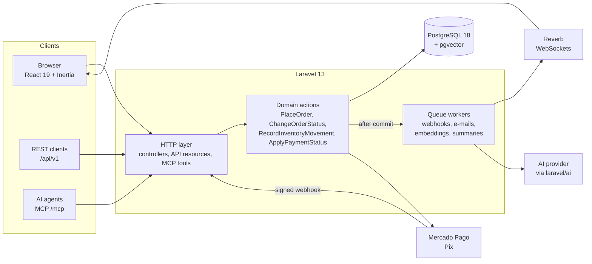

# Renice

[](https://github.com/lopesDilceu/ReniceProject/actions/workflows/ci.yml)

**English** · [Português](README.pt-BR.md)

An e-commerce store for a Brazilian brand, built on Laravel 13, React 19 and PostgreSQL with pgvector. It takes Pix payments, signs in with passkeys, searches by meaning, summarizes reviews with AI, and lets AI agents shop through an MCP server, without ever letting them spend the customer's money.

It started as a university project in 2024 and was rebuilt, in the open, to a 2026 production standard ([`v2.0.0`](https://github.com/lopesDilceu/ReniceProject/releases/tag/v2.0.0)). The [case study](docs/case-study.md) tells that story.


**See it:** the [showcase](docs/showcase.md) puts every v1 screen next to its v2 version. **Try it:** with Docker, `docker compose -f compose.demo.yaml up --build` starts the demo store at http://localhost:8000 ([details](docs/showcase.md#run-it-yourself)).

## Highlights

The parts that took engineering, not scaffolding:

- **AI agents that can shop but cannot pay.** An [MCP server](docs/mcp.md) gives assistants such as Claude or ChatGPT eight tools to search, read products and fill a cart, behind scoped tokens. Checkout returns a signed, 15-minute link that pins the customer, address and exact cart, and only the signed-in customer can confirm it. An agent misled by prompt injection can, at most, fill a cart.
- **Search by meaning.** "copo com desenho japonês" finds the anime cup. Keyword and vector candidates (pgvector, HNSW index) are merged with Reciprocal Rank Fusion. Embeddings are cached, time-boxed and re-computed only when the text changes, and keyword search keeps working when the provider is down ([search](docs/search.md), [ADR 0007](docs/adr/0007-semantic-search-with-pgvector.md)).
- **AI review summaries with cost control.** Structured output (a one-sentence summary, pros and cons), labeled as AI, debounced so a burst of reviews costs one call, skipped when nothing changed, and versioned so a prompt change re-summarizes ([review summaries](docs/review-summaries.md)).
- **Payments that cannot be forged or applied twice.** Pix through Mercado Pago: HMAC-verified webhooks, idempotency at three levels (charge, notification, status), and the provider's API, not the webhook body, as the source of truth ([payments](docs/payments.md), [ADR 0006](docs/adr/0006-pix-with-mercado-pago.md)).
- **Stock that cannot be oversold.** An append-only inventory ledger with row locks. A test fires 8 concurrent checkouts at the last unit on PostgreSQL: exactly one wins. Unpaid orders release their stock after 60 minutes.
- **Passwordless sign-in.** Passkeys (WebAuthn) and TOTP two-factor authentication with recovery codes.
- **Realtime without lying.** The admin dashboard and the customer's order page update over WebSockets (Laravel Reverb). Events go out only after the transaction commits, so a rolled-back change is never shown, and pages fall back to polling.
- **An API with a contract.** REST `/api/v1` with scoped, expiring tokens. The OpenAPI 3.1 document is generated from the code, real responses are validated against it, and CI fails when it drifts ([API](docs/api/README.md)).
- **Ready to run in production.** One Docker image for web, queue, scheduler and WebSockets, built and booted by CI on every pull request. `/health` checks, request ids in JSON logs and Laravel Pulse ([deploy](docs/deploy.md), [observability](docs/observability.md)).

| | | |
|---|---|---|
|  |  |  |
| Admin dashboard, live | Pix checkout | Append-only stock ledger |

More in the [showcase](docs/showcase.md): dark mode, phone, passkeys, API docs and monitoring.

## Architecture



Every way into the system (web page, REST API, MCP tool, webhook, scheduler) goes through the same small set of **domain actions**, so a rule such as "stock never goes below zero" or "a status change is always recorded" lives in one tested place. The [ADRs](docs/adr/README.md) explain the larger choices: Inertia + React, rules in the application instead of database triggers, PostgreSQL, Mercado Pago and pgvector.

## By the numbers

| | v1.0-academic (2024) | v2.0.0 (2026) |
|---|---|---|
| Automated tests | 0 | 446, on SQLite and PostgreSQL |
| Line coverage | 0% | 93.4% |
| Static analysis | none | Larastan level 6, no baseline |
| Open audit findings | 28 | 0 |
| Known vulnerable dependencies | 5 | 0 |
| Overselling under concurrency | not handled | tested: 8 concurrent buyers, 1 sale |

More in [`docs/metrics.md`](docs/metrics.md).

## The story

Renice is a fictional brand that sells ready-to-drink cups with ice. In June 2024 it became the final project for two courses in the Information Systems program at Unimontes: a Laravel storefront with an admin back office (Programming II) and a MySQL design built on stored procedures and triggers (Database II).

That version is frozen at [`v1.0-academic`](https://github.com/lopesDilceu/ReniceProject/releases/tag/v1.0-academic). This repository now documents the work of taking it from coursework to a codebase I would put in production:

1. **Audit:** 28 findings, from privilege escalation and SQL injection to business rules hidden in triggers ([read the audit](docs/audit/initial-audit.md)).
2. **Platform:** Laravel 11 → 13, PHP 8.4+, CI with static analysis and tests.
3. **Data layer:** a versioned schema and business rules moved from the database into tested application code.
4. **Frontend:** a rewrite with Inertia, React and TypeScript.
5. **Commerce:** order lifecycle, Pix payments with webhooks, concurrency-safe inventory.
6. **2026 features:** semantic search, AI review summaries, a realtime admin, a public API and an MCP server for AI agents.

Every step is an issue, a pull request and, when there is a real trade-off, an [architecture decision record](docs/adr/README.md).

## Progress

| Phase | Status |
|---|---|
| 0 — Foundation | Done ([`v2.0.0-alpha.1`](https://github.com/lopesDilceu/ReniceProject/releases/tag/v2.0.0-alpha.1)) |
| 1 — Framework upgrade | Done ([`v2.0.0-alpha.2`](https://github.com/lopesDilceu/ReniceProject/releases/tag/v2.0.0-alpha.2)) |
| 2 — Data layer redesign | Done ([`v2.0.0-alpha.3`](https://github.com/lopesDilceu/ReniceProject/releases/tag/v2.0.0-alpha.3)) |
| 3 — Inertia + React rewrite | Done ([`v2.0.0-beta.1`](https://github.com/lopesDilceu/ReniceProject/releases/tag/v2.0.0-beta.1)) |
| 4 — Commerce core | Done ([`v2.0.0-beta.2`](https://github.com/lopesDilceu/ReniceProject/releases/tag/v2.0.0-beta.2)) |
| 5 — Showcase features | Done ([`v2.0.0-rc.1`](https://github.com/lopesDilceu/ReniceProject/releases/tag/v2.0.0-rc.1)) |
| 6 — Production & case study | Done ([`v2.0.0`](https://github.com/lopesDilceu/ReniceProject/releases/tag/v2.0.0)) |

Before/after numbers are tracked in [`docs/metrics.md`](docs/metrics.md).

## Stack

| | v1.0-academic | v2.0.0 |
|---|---|---|
| Backend | Laravel 11, PHP 8.2 | Laravel 13, PHP 8.4+ |
| Frontend | Blade, Bootstrap, jQuery | Inertia 3, React 19 (React Compiler), TypeScript, Tailwind 4, shadcn/ui, Wayfinder |
| Database | MySQL | PostgreSQL 18 + pgvector |
| Business rules | MySQL procedures and triggers | Tested application code |
| Payments | none (orders marked completed at once) | Pix through Mercado Pago, with signed, idempotent webhooks |
| API | none | REST `/api/v1` (Sanctum tokens with scopes), OpenAPI 3.1 generated from code, contract-tested |
| AI agents | none | MCP server (`laravel/mcp`) with scoped tools; checkout needs the customer's confirmation in the store |
| Local environment | manual | Docker (Laravel Sail) |
| Quality | — | Pest, Larastan (level 6), Pint, GitHub Actions |

## Documentation

| | |
|---|---|
| [Showcase](docs/showcase.md) | v1 and v2 side by side, the purchase GIF, and the one-command demo |
| [Case study](docs/case-study.md) | The whole story: audit, decisions, hard problems, before/after, lessons |
| [Original system](docs/legacy/README.md) | What v1 did, its database design and screenshots |
| [Initial audit](docs/audit/initial-audit.md) | Security, correctness and design findings |
| [Database](docs/database.md) | Schema diagram and design rules |
| [Payments](docs/payments.md) | Pix flow, webhook guarantees and the Mercado Pago sandbox |
| [REST API](docs/api/README.md) | `/api/v1` with Sanctum tokens; OpenAPI document at `/docs/api` |
| [MCP server](docs/mcp.md) | Tools for AI agents at `/mcp`; orders always confirmed by the customer |
| [Search](docs/search.md) | Hybrid keyword + semantic search (pgvector), measurements and cost |
| [AI review summaries](docs/review-summaries.md) | Pros and cons per product, labeled as AI, debounced and versioned |
| [Observability](docs/observability.md) | `/health`, request ids in JSON logs, Laravel Pulse |
| [Deploy](docs/deploy.md) | Production image, deploy from `main`, environment, public demo |
| [Roadmap](docs/roadmap.md) | Phases, milestones and issues |
| [Metrics](docs/metrics.md) | Baseline and progress |
| [Decisions](docs/adr/README.md) | Architecture Decision Records |
| [Contributing](CONTRIBUTING.md) | Workflow, commits and releases |
| [Changelog](CHANGELOG.md) | Notable changes per release |

## Running locally

Requirements: Docker. The environment runs on [Laravel Sail](https://laravel.com/docs/sail): PHP 8.5, PostgreSQL 18 with pgvector ([ADR 0005](docs/adr/0005-postgresql.md)) and Mailpit.

```bash
composer install            # or: docker run --rm -v "$(pwd)":/app -w /app composer install
cp .env.example .env
vendor/bin/sail up -d
vendor/bin/sail artisan key:generate
vendor/bin/sail artisan migrate --seed
vendor/bin/sail artisan storage:link
```

**Windows without WSL:** the `sail` script only runs on Linux, macOS and WSL2. Use Docker Compose directly from PowerShell. It is the same stack, and `.env.example` already has the `WWWUSER`/`WWWGROUP` values it needs:

```powershell
docker compose up -d
docker compose exec laravel.test php artisan key:generate
docker compose exec laravel.test php artisan migrate --seed
docker compose exec laravel.test php artisan storage:link
```

For better file-system performance, Laravel recommends keeping the project inside the WSL2 file system and using `sail` from there.

| Service | URL |
|---|---|
| Application | http://localhost |
| Mailpit (caught e-mails) | http://localhost:8025 |
| Reverb (WebSockets) | `ws://localhost:8080` |
| Health / Pulse (admins) | http://localhost/health · http://localhost/pulse |
| PostgreSQL | `localhost:5432`, user `sail`, password `password` |

The seed builds a demo store with the original product line, nine customers, orders, stock history and reviews, all through the real domain actions. Run `migrate:fresh --seed` to reset it.

`docker compose up -d` also starts three background services from the same image:

| Service | What it does |
|---|---|
| `queue` (`queue:work`) | Processes payment notifications, sends the queued e-mails and pushes the live updates. E-mails: order confirmation, payment confirmed, shipped, cancelled (with the reason), and low-stock alerts for admins. They show up in Mailpit. The seed queues nothing for its fictional customers. |
| `scheduler` (`schedule:work`) | Cancels unpaid orders after 60 minutes (`SHOP_PAYMENT_WINDOW_MINUTES`) and releases their stock. `php artisan orders:expire-unpaid` does it by hand. |
| `reverb` (`reverb:start`) | WebSockets on port 8080. The admin dashboard and order list show new orders, confirmed payments and low stock live ("Ao vivo"), and the customer's order page turns to "Pago" as soon as the Pix is confirmed. Without it, the pages fall back to polling. |

Payments use a local fake gateway by default: checkout shows a real QR code, and the order page has a **Simular pagamento** button. To use the Mercado Pago sandbox instead, see [`docs/payments.md`](docs/payments.md).

| Demo account | E-mail | Password |
|---|---|---|
| Admin | `admin@renice.test` | `password` |
| Customer | `cliente@renice.test` | `password` |

The schema is documented in [`docs/database.md`](docs/database.md).

Quality checks (no Docker needed; tests use in-memory SQLite):

```bash
composer check   # Pint, Larastan and Pest, as in CI
```

## Authors

- **Dilceu Lopes:** application, database and modernization
- **Renan Iago Figueiredo Silva Ciríaco:** database design in v1

## License

[MIT](LICENSE)
