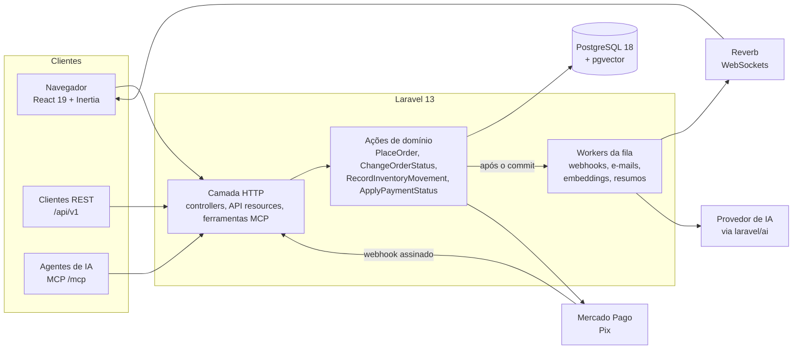

# Renice

[English](README.md) · **Português**

Uma loja virtual de uma marca brasileira, feita com Laravel 13, React 19 e PostgreSQL com pgvector. Ela recebe Pix, tem login com passkeys, busca por significado, resume avaliações com IA e deixa agentes de IA comprarem por um servidor MCP, sem nunca deixá-los gastar o dinheiro do cliente.

Nasceu como projeto de faculdade em 2024 e foi reconstruída, em público, no padrão de produção de 2026 ([`v2.0.0`](https://github.com/lopesDilceu/ReniceProject/releases/tag/v2.0.0)). O [estudo de caso](docs/case-study.md) conta essa história.

**Veja:** a [vitrine](docs/showcase.md) coloca cada tela da v1 ao lado da versão v2. **Experimente:** com Docker, `docker compose -f compose.demo.yaml up --build` sobe a loja de demonstração em http://localhost:8000 ([detalhes](docs/showcase.md#run-it-yourself), em inglês). Entre com `cliente@renice.test` ou `admin@renice.test`, senha `password`.

## Destaques

As partes que exigiram engenharia, não só scaffolding (documentação técnica em inglês):

- **Agentes de IA que compram, mas não pagam.** Um [servidor MCP](docs/mcp.md) dá a assistentes como Claude ou ChatGPT oito ferramentas para buscar, ver produtos e montar o carrinho, com tokens de escopo limitado. O checkout devolve um link assinado de 15 minutos que fixa o cliente, o endereço e o carrinho exato, e só o cliente logado pode confirmá-lo. Um agente enganado por prompt injection consegue, no máximo, encher um carrinho.
- **Busca por significado.** "copo com desenho japonês" encontra o copo anime. Candidatos por palavra-chave e por vetor (pgvector, índice HNSW) são combinados com Reciprocal Rank Fusion. Os embeddings têm cache e timeout, só são recalculados quando o texto muda, e a busca por palavra-chave continua funcionando se o provedor cair ([busca](docs/search.md), [ADR 0007](docs/adr/0007-semantic-search-with-pgvector.md)).
- **Resumos de avaliações com IA e custo controlado.** Saída estruturada (uma frase, prós e contras), identificada como IA, com debounce para que uma rajada de avaliações custe uma chamada, ignorada quando nada mudou e versionada para que uma mudança no prompt gere novos resumos ([resumos](docs/review-summaries.md)).
- **Pagamentos que não podem ser forjados nem aplicados duas vezes.** Pix pelo Mercado Pago: webhooks verificados por HMAC, idempotência em três níveis (cobrança, notificação, status) e a API do provedor, não o corpo do webhook, como fonte da verdade ([pagamentos](docs/payments.md), [ADR 0006](docs/adr/0006-pix-with-mercado-pago.md)).
- **Estoque que não pode ser vendido além do que existe.** Um livro-razão de estoque só de inserção, com locks de linha. Um teste dispara 8 checkouts simultâneos pela última unidade no PostgreSQL: exatamente um vence. Pedidos não pagos liberam o estoque após 60 minutos.
- **Login sem senha.** Passkeys (WebAuthn) e verificação em duas etapas por TOTP, com códigos de recuperação.
- **Tempo real sem mentir.** O painel do admin e a página do pedido do cliente se atualizam por WebSockets (Laravel Reverb). Os eventos só saem depois do commit da transação, então uma alteração desfeita nunca aparece, e as páginas recorrem a polling.
- **Uma API com contrato.** REST `/api/v1` com tokens com escopo e validade. O documento OpenAPI 3.1 é gerado do código, as respostas reais são validadas contra ele e o CI falha se ele ficar desatualizado ([API](docs/api/README.md)).
- **Pronta para produção.** Uma imagem Docker para web, fila, agendador e WebSockets, construída e iniciada pelo CI em todo pull request. Health check em `/health`, request ids em logs JSON e Laravel Pulse ([deploy](docs/deploy.md), [observabilidade](docs/observability.md)).

| | | |
|---|---|---|
|  |  |  |
| Painel do admin, ao vivo | Checkout com Pix | Histórico de estoque só de inserção |

Mais na [vitrine](docs/showcase.md): modo escuro, celular, passkeys, documentação da API e monitoramento.

## Arquitetura

Toda entrada no sistema (página web, API REST, ferramenta MCP, webhook, agendador) passa pelo mesmo pequeno conjunto de **ações de domínio**. Assim, uma regra como "o estoque nunca fica negativo" ou "toda mudança de status é registrada" mora num único lugar testado. Os [ADRs](docs/adr/README.md) explicam as escolhas maiores.

## Em números

| | v1.0-academic (2024) | v2.0.0 (2026) |
|---|---|---|
| Testes automatizados | 0 | 446, em SQLite e PostgreSQL |
| Cobertura de linhas | 0% | 93,4% |
| Análise estática | nenhuma | Larastan nível 6, sem baseline |
| Achados da auditoria em aberto | 28 | 0 |
| Dependências com vulnerabilidade conhecida | 5 | 0 |
| Venda além do estoque sob concorrência | não tratada | testada: 8 compradores simultâneos, 1 venda |

Mais em [`docs/metrics.md`](docs/metrics.md).

## A história

Renice é uma marca fictícia de copos com gelo prontos para consumo. Em junho de 2024 ela virou o trabalho final de duas disciplinas de Sistemas de Informação na Unimontes: uma loja em Laravel com painel administrativo (Programação II) e um banco MySQL baseado em stored procedures e triggers (Banco de Dados II).

Essa versão está congelada na tag [`v1.0-academic`](https://github.com/lopesDilceu/ReniceProject/releases/tag/v1.0-academic). Este repositório agora documenta o trabalho de levá-la de trabalho acadêmico a um código que eu colocaria em produção:

1. **Auditoria:** 28 achados, de escalada de privilégio e SQL injection a regras de negócio escondidas em triggers ([ler a auditoria](docs/audit/initial-audit.md), em inglês).
2. **Plataforma:** Laravel 11 → 13, PHP 8.4+, CI com análise estática e testes.
3. **Camada de dados:** schema versionado e regras de negócio saindo do banco para código testado.
4. **Frontend:** reescrita com Inertia, React e TypeScript.
5. **Comércio:** ciclo de vida do pedido, pagamento via Pix com webhooks e estoque seguro sob concorrência.
6. **Recursos de 2026:** busca semântica, resumo de avaliações com IA, admin em tempo real, API pública e servidor MCP para agentes de IA.

Cada passo é uma issue, um pull request e, quando há um trade-off real, um [registro de decisão de arquitetura](docs/adr/README.md).

## Progresso

| Fase | Status |
|---|---|
| 0 — Fundação | Concluída ([`v2.0.0-alpha.1`](https://github.com/lopesDilceu/ReniceProject/releases/tag/v2.0.0-alpha.1)) |
| 1 — Upgrade do framework | Concluída ([`v2.0.0-alpha.2`](https://github.com/lopesDilceu/ReniceProject/releases/tag/v2.0.0-alpha.2)) |
| 2 — Redesenho da camada de dados | Concluída ([`v2.0.0-alpha.3`](https://github.com/lopesDilceu/ReniceProject/releases/tag/v2.0.0-alpha.3)) |
| 3 — Reescrita com Inertia + React | Concluída ([`v2.0.0-beta.1`](https://github.com/lopesDilceu/ReniceProject/releases/tag/v2.0.0-beta.1)) |
| 4 — Núcleo de comércio | Concluída ([`v2.0.0-beta.2`](https://github.com/lopesDilceu/ReniceProject/releases/tag/v2.0.0-beta.2)) |
| 5 — Recursos de destaque | Concluída ([`v2.0.0-rc.1`](https://github.com/lopesDilceu/ReniceProject/releases/tag/v2.0.0-rc.1)) |
| 6 — Produção e estudo de caso | Concluída ([`v2.0.0`](https://github.com/lopesDilceu/ReniceProject/releases/tag/v2.0.0)) |

Os números de antes e depois ficam em [`docs/metrics.md`](docs/metrics.md).

## Documentação

A documentação técnica está em inglês. Comece pelo [estudo de caso](docs/case-study.md), que conta a história completa, ou veja a [versão em inglês deste README](README.md#documentation) para o índice completo.

## Autores

- **Dilceu Lopes:** aplicação, banco de dados e modernização
- **Renan Iago Figueiredo Silva Ciríaco:** projeto do banco de dados na v1

## Licença

[MIT](LICENSE)
