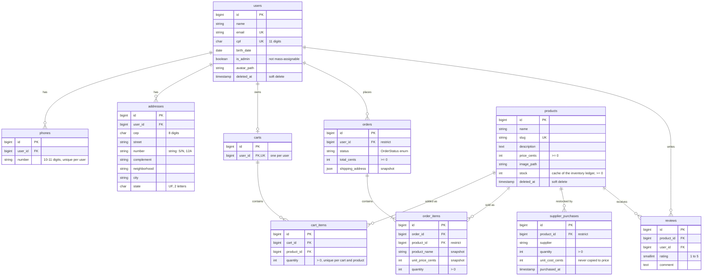

# Database

PostgreSQL 18 with pgvector ([ADR 0005](adr/0005-postgresql.md)). Names follow Laravel conventions in English ([ADR 0003](adr/0003-schema-naming-conventions.md)). Business rules live in the application ([ADR 0002](adr/0002-business-rules-in-the-application.md)). The database enforces integrity: foreign keys, unique indexes and CHECK constraints.

## Design rules

| Rule | Why | Audit |
|---|---|---|
| Money is stored as integer cents (`*_cents`) | No floating-point rounding; sums are exact | — |
| Orders snapshot product name, unit price and shipping address | Renaming, repricing or moving must not rewrite past orders. v1 already snapshotted price; name and address are new | — |
| Users and products are soft-deleted; orders and supplier purchases `restrict` hard deletes | Financial history is never lost. v1 deleted purchase history through a trigger | DM-07 |
| Supplier cost is a separate column from sale price | v1's trigger overwrote the sale price with cost on every restock | BUG-01, [#14](https://github.com/lopesDilceu/ReniceProject/issues/14) |
| `is_admin` and `stock` are not mass-assignable | Role changes and stock changes go through explicit actions only | SEC-01, [#17](https://github.com/lopesDilceu/ReniceProject/issues/17) |
| Phones have a surrogate key plus a unique index | Eloquent does not support composite primary keys | DM-02 |
| Unique: CPF, one cart per user, one review per user and product, one phone number per user | v1 had none of these | DM-04 |
| Address number is a string; state is `char(2)` | "S/N" and "12A" are valid numbers | DM-03 |
| CHECK constraints on amounts, quantities, rating, CPF, CEP and UF (PostgreSQL) | Integrity no matter which code path writes; PostgreSQL ignores `unsigned` | — |

## Coming next

- **Inventory movements ledger** ([#12](https://github.com/lopesDilceu/ReniceProject/issues/12)): append-only history of every stock change. `products.stock` becomes its cached sum.
- **Embeddings** ([#36](https://github.com/lopesDilceu/ReniceProject/issues/36)): a `vector` column on products for semantic search.

## Testing

The default test run uses in-memory SQLite. The CI job *Migrations and tests on PostgreSQL* runs migrations up, down and up again, then the full suite, including the PostgreSQL-only CHECK constraint tests (`tests/Feature/Database/PostgresConstraintsTest.php`).
