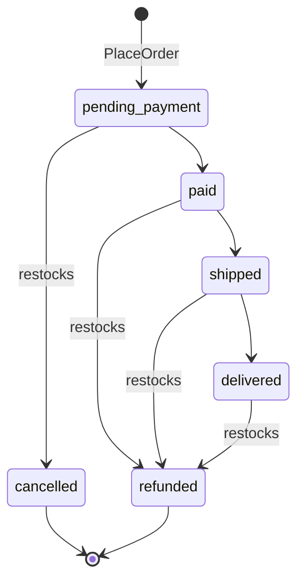

# Database

PostgreSQL 18 with pgvector ([ADR 0005](adr/0005-postgresql.md)). Names follow Laravel conventions in English ([ADR 0003](adr/0003-schema-naming-conventions.md)). Business rules live in the application ([ADR 0002](adr/0002-business-rules-in-the-application.md)). The database enforces integrity: foreign keys, unique indexes and CHECK constraints.

```mermaid
erDiagram
    users ||--o{ phones : has
    users ||--o{ addresses : has
    users ||--o| carts : owns
    users ||--o{ orders : places
    users ||--o{ reviews : writes
    carts ||--o{ cart_items : contains
    products ||--o{ cart_items : "added as"
    products ||--o{ order_items : "sold as"
    products ||--o{ supplier_purchases : "restocked by"
    products ||--o{ reviews : receives
    products ||--o{ inventory_movements : "stock changed by"
    users ||--o{ inventory_movements : "triggered"
    orders ||--|{ order_items : contains
    orders ||--|{ order_status_changes : "timeline"
    users ||--o{ order_status_changes : "made"

    users {
        bigint id PK
        string name
        string email UK
        char cpf UK "11 digits"
        date birth_date
        boolean is_admin "not mass-assignable"
        string avatar_path
        timestamp deleted_at "soft delete"
    }
    phones {
        bigint id PK
        bigint user_id FK
        string number "10-11 digits, unique per user"
    }
    addresses {
        bigint id PK
        bigint user_id FK
        char cep "8 digits"
        string street
        string number "string: S/N, 12A"
        string complement
        string neighborhood
        string city
        char state "UF, 2 letters"
    }
    products {
        bigint id PK
        string name
        string slug UK
        text description
        int price_cents ">= 0"
        string image_path
        int stock "cache of the inventory ledger, >= 0"
        timestamp deleted_at "soft delete"
    }
    supplier_purchases {
        bigint id PK
        bigint product_id FK "restrict"
        string supplier
        int quantity "> 0"
        int unit_cost_cents "never copied to price"
        timestamp purchased_at
    }
    carts {
        bigint id PK
        bigint user_id FK,UK "one per user"
    }
    cart_items {
        bigint id PK
        bigint cart_id FK
        bigint product_id FK
        int quantity "> 0, unique per cart and product"
    }
    orders {
        bigint id PK
        bigint user_id FK "restrict"
        string status "OrderStatus enum"
        int total_cents ">= 0"
        json shipping_address "snapshot"
        timestamp payment_due_at "stock reserved until then"
    }
    order_items {
        bigint id PK
        bigint order_id FK
        bigint product_id FK "restrict"
        string product_name "snapshot"
        int unit_price_cents "snapshot"
        int quantity "> 0"
    }
    reviews {
        bigint id PK
        bigint product_id FK
        bigint user_id FK
        smallint rating "1 to 5"
        text comment
    }
    inventory_movements {
        bigint id PK
        bigint product_id FK "restrict"
        string type "purchase, reservation, release, return, adjustment"
        int quantity "signed, not zero"
        int stock_after "running balance, >= 0"
        morph source "supplier purchase, order..."
        bigint user_id FK "actor, nullable"
        string note
        timestamp created_at "no updated_at: append-only"
    }
    order_status_changes {
        bigint id PK
        bigint order_id FK
        string from_status "null when placed"
        string to_status "differs from from_status"
        bigint user_id FK "actor, null for the system"
        string reason "required to cancel or refund"
        timestamp created_at "no updated_at: append-only"
    }
```

## Design rules

| Rule | Why | Audit |
|---|---|---|
| Money is stored as integer cents (`*_cents`) | No floating-point rounding; sums are exact | — |
| Orders snapshot product name, unit price and shipping address | Renaming, repricing or moving must not rewrite past orders. v1 already snapshotted price; name and address are new | — |
| Users and products are soft-deleted; orders and supplier purchases `restrict` hard deletes | Financial history is never lost. v1 deleted purchase history through a trigger | DM-07 |
| Supplier cost is a separate column from sale price | v1's trigger overwrote the sale price with cost on every restock | BUG-01, [#14](https://github.com/lopesDilceu/ReniceProject/issues/14) |
| `is_admin` and `stock` are not mass-assignable | Role changes and stock changes go through explicit actions only | SEC-01, [#17](https://github.com/lopesDilceu/ReniceProject/issues/17) |
| Phones have a surrogate key plus a unique index | Eloquent does not support composite primary keys | DM-02 |
| Unique: CPF, one cart per user, one review per user and product, one phone number per user | v1 had none of these | DM-04 |
| Address number is a string; state is `char(2)` | "S/N" and "12A" are valid numbers | DM-03 |
| CHECK constraints on amounts, quantities, rating, CPF, CEP and UF (PostgreSQL) | Integrity no matter which code path writes; PostgreSQL ignores `unsigned` | — |

## Inventory ledger

Stock is never edited directly. Every change goes through `App\Actions\Inventory\RecordInventoryMovement`, which in one transaction:

1. locks the product row (`SELECT … FOR UPDATE`), so concurrent writers queue instead of overselling;
2. refuses the change if the balance would go negative (`InsufficientStock`);
3. appends a movement with the signed quantity, the resulting balance, its source record and actor;
4. updates `products.stock`, the cached balance.

Movements are append-only: the model throws on update or delete, and a correction is a new `adjustment`. This replaces v1's `atualizar_estoque_produto` procedure and its four triggers. Supplier purchases go through `RecordSupplierPurchase`, which records cost on the purchase and adds a `purchase` movement. It never copies cost into the sale price, which was v1's BUG-01.

### Stock reservation

| Movement | When | Quantity |
|---|---|---|
| `reservation` | `PlaceOrder`: checkout takes the units while the order waits for payment | negative |
| `release` | The order is cancelled, by an admin or because the payment window closed | positive |
| `return` | A paid order is refunded | positive |

A paid order keeps its reservation, because the units are sold. `PlaceOrder` sets `orders.payment_due_at` to now plus `SHOP_PAYMENT_WINDOW_MINUTES` (30 by default). Every minute, the scheduler runs `orders:expire-unpaid` (`App\Actions\Orders\ExpireUnpaidOrders`), which cancels overdue orders as the system and releases their stock. A payment that arrives at the same moment is safe: `ChangeOrderStatus` re-reads the status under a row lock, so the order ends up either paid or expired, never both.

**Overselling** is prevented by row locks. `PlaceOrder` locks the cart and its products in id order, and `RecordInventoryMovement` locks the product again. `tests/Feature/Checkout/ConcurrentCheckoutTest.php` proves it on PostgreSQL: eight separate PHP processes check out the last unit at the same instant, and exactly one succeeds. With the locks removed, the same test sold that unit three times.

## Order lifecycle

`App\Enums\OrderStatus` defines the allowed transitions. `App\Actions\Orders\ChangeOrderStatus` is the only code that changes a status. In one transaction it:

1. locks the order row;
2. throws `InvalidOrderTransition` if the lifecycle doesn't allow the move, or if a cancellation or refund has no reason;
3. updates `orders.status` and appends a row to `order_status_changes` with the previous status, the actor and the reason;
4. when cancelling or refunding, puts the items back in stock through the inventory ledger (`release` or `return`).

`PlaceOrder` writes the first timeline row. The timeline is append-only, like the ledger. Admins see who made each change; when the actor is null, the system made it (payment webhooks and Pix expiry, [#33](https://github.com/lopesDilceu/ReniceProject/issues/33)). Customers see the status, the date and the reason, but not which admin made the change.

## Coming next

- **Embeddings** ([#36](https://github.com/lopesDilceu/ReniceProject/issues/36)): a `vector` column on products for semantic search.

## Testing

The default test run uses in-memory SQLite. The CI job *Migrations and tests on PostgreSQL* runs migrations up, down and up again, then the full suite, including the PostgreSQL-only CHECK constraint tests (`tests/Feature/Database/PostgresConstraintsTest.php`).
