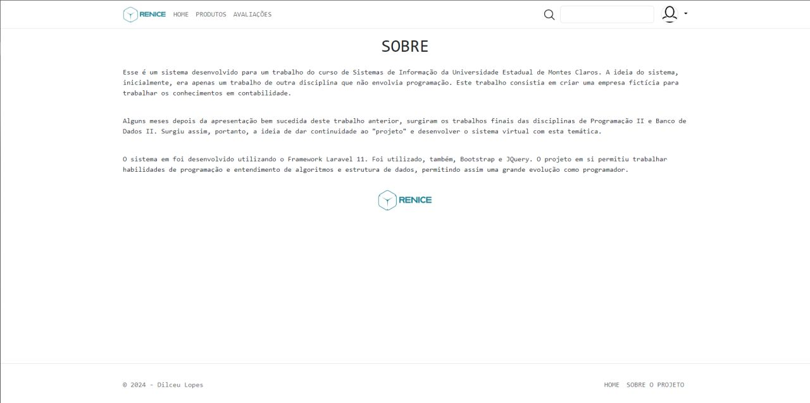

# Renice v1 — the original university project

This folder documents Renice **as it was delivered in June 2024**, before any modernization. The code is frozen at the tag [`v1.0-academic`](https://github.com/lopesDilceu/ReniceProject/releases/tag/v1.0-academic):

```bash
git checkout v1.0-academic
```

## Origin

Renice began as a fictional company created for an accounting course in the Information Systems program at **Universidade Estadual de Montes Claros (Unimontes)**. A few months later the same brand became the subject of the final projects for two other courses:

- **Programming II:** the Laravel web application in this repository.
- **Database II:** the relational model, views, stored procedures and triggers, delivered as a written report (*Seminário II – Trabalho Final*).

**Authors:** Dilceu Lopes (application and database) and Renan Iago Figueiredo Silva Ciríaco (database).

## What it did

The store sold ready-to-drink cups with ice.

| Customer | Admin |
|---|---|
| Product catalog with search, sorted by stock | Products: create, edit, soft delete |
| Cart with quantity controls | Inventory overview |
| Checkout with delivery address | Supplier purchases (stock intake) |
| Order history and order details | Sales list with order details |
| Product reviews (1–5 stars) | User management |
| Profile with photo, phones and address | Review moderation |

## Stack

| Layer | Technology |
|---|---|
| Backend | PHP 8.2, Laravel 11.10 |
| Views | Blade, Bootstrap 5.3, jQuery 3.6, jQuery Mask, jQuery MaskMoney (all from CDNs) |
| Notifications | yoeunes/toastr |
| Database | MySQL |

## Architecture

A classic server-rendered MVC application with an unusual split of responsibilities: **much of the business logic lived in the database**.

```
Browser ──► routes/web.php ──► Controllers (12) ──► Eloquent models (11) ──► MySQL
                                    │                                        │
                                    └── Blade views + modals                 ├── 2 stored procedures
                                                                             ├── 8 triggers
                                                                             └── 2 views
```

### Database objects (from the Database II report)

**Tables (11):** Users, Telefones, Enderecos, Produtos, Estoque, Compras, Carrinho, ItensCarrinho, Vendas, ItensVenda, Avaliacoes.

**Stored procedures**

| Name | Purpose |
|---|---|
| `atualizar_estoque_produto(produto, quantidade, operacao)` | Adds stock on `compra`, subtracts on `venda`, fails with *insufficient stock* |
| `finalizar_venda(carrinho)` | Creates the sale, copies cart items into sale items with the current price, empties the cart |

**Triggers**

| Name | Effect |
|---|---|
| `after_produto_insert` | Creates an inventory row with quantity 0 |
| `after_produto_update` | Copies the new product name into the inventory row |
| `before_produto_delete` | Deletes the inventory row |
| `before_produto_delete_compras` | Deletes the product's supplier purchases |
| `after_compra_insert` | Adds stock and sets the product price to the purchase cost |
| `after_itensvenda_insert` | Subtracts stock for each sold item |
| `before_user_delete_telefone` / `before_user_delete_endereco` | Delete the user's phones and addresses |

**Views:** `vw_ProdutosMaisVendidos` (best sellers) and `vw_ProdutosEmEstoque` (products in stock).

None of these objects, nor the domain tables, were versioned in the repository. The [initial audit](../audit/initial-audit.md) covers the consequences and what changes.

## Screenshots

### Storefront

| Home | About |
|---|---|
|  |  |

| Product catalog | Cart |
|---|---|
|  |  |

| Order confirmation | My orders |
|---|---|
|  |  |

| Order details | Product review |
|---|---|
|  |  |

### Admin

| Dashboard | Products |
|---|---|
|  |  |

| New product |
|---|
|  |
