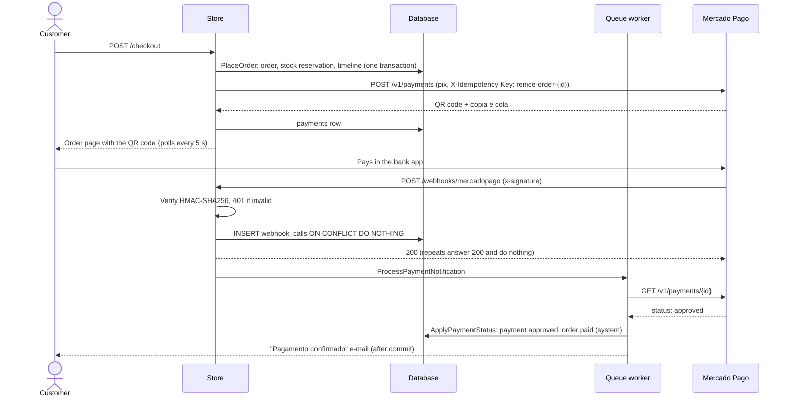

# Payments

Pix through Mercado Pago, behind the `App\Payments\PaymentGateway` interface ([ADR 0006](adr/0006-pix-with-mercado-pago.md)). By default the store uses a local fake gateway, so it runs without any account.

## Flow



## Guarantees

| Risk | Guard |
|---|---|
| Charging twice (double click, retry after a timeout) | One `payments` row per order (unique), and the same `X-Idempotency-Key` for every attempt, so Mercado Pago returns the same charge |
| Forged webhook | HMAC-SHA256 signature over `id:{data.id};request-id:{x-request-id};ts:{ts};`, compared in constant time. With no secret configured, every notification is refused |
| Forged or stale webhook body | The body is never trusted. The job reads the status back from the API |
| Replayed or retried notification | `webhook_calls` is unique per (provider, notification id); a repeat answers 200 and does nothing |
| Out-of-order or duplicate status | `ApplyPaymentStatus` locks the payment row and ignores a status it already has. Order transitions go through `ChangeOrderStatus`, which refuses invalid moves |
| Provider down at checkout | The order and its reservation are kept; the customer generates the Pix from the order page ("Gerar Pix") |
| Provider down during a webhook | The job retries 5 times (10 s, 1 min, 5 min); Mercado Pago also keeps retrying unanswered notifications |
| Paying an expired order | The Pix expires with the order, and a cancelled order's charge is cancelled at the provider. If a payment still lands, the order stays cancelled and a warning asks for a refund |

## Statuses

| Mercado Pago | Store | Effect on the order |
|---|---|---|
| `pending`, `in_process`, `authorized`, `in_mediation` | pending | — |
| `approved` | approved | Paid (by the system, "Pix confirmado.") |
| `rejected` | rejected | — (it expires at the deadline) |
| `cancelled` (also an expired Pix) | cancelled | — (it expires at the deadline) |
| `refunded`, `charged_back` | refunded | Refunded, stock returned |

## Running the sandbox

1. Create an application in [Mercado Pago Developers](https://www.mercadopago.com.br/developers/panel/app) and copy its **test** access token.
2. Expose the local app on a public HTTPS URL (for example `cloudflared tunnel --url http://localhost`).
3. Under **Webhooks** in the application, set the URL to `https://<tunnel>/webhooks/mercadopago`, select the **Pagamentos** event, and copy the secret signature.
4. In `.env`:

   ```dotenv
   PAYMENT_GATEWAY=mercadopago
   MERCADOPAGO_ACCESS_TOKEN=TEST-...
   MERCADOPAGO_WEBHOOK_SECRET=...
   ```

5. Keep `php artisan queue:work` running, since it processes the notifications.

With `PAYMENT_GATEWAY=fake`, the order page shows a **Simular pagamento** button. It goes through `ApplyPaymentStatus`, the same path a webhook takes. The route answers 404 with a real gateway.
